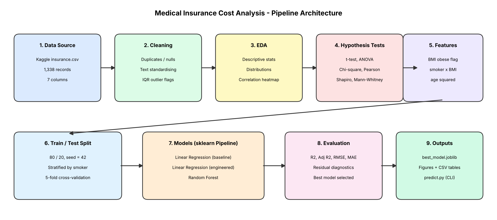
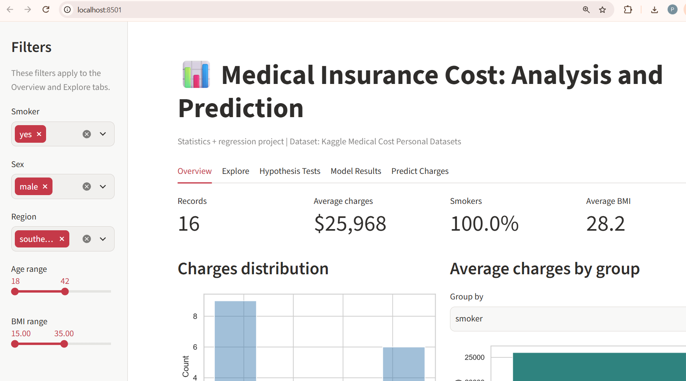
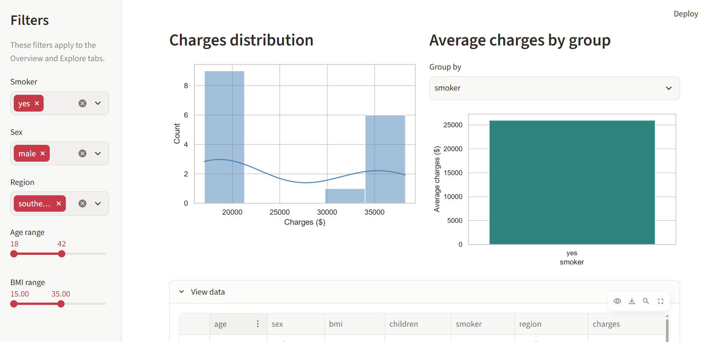
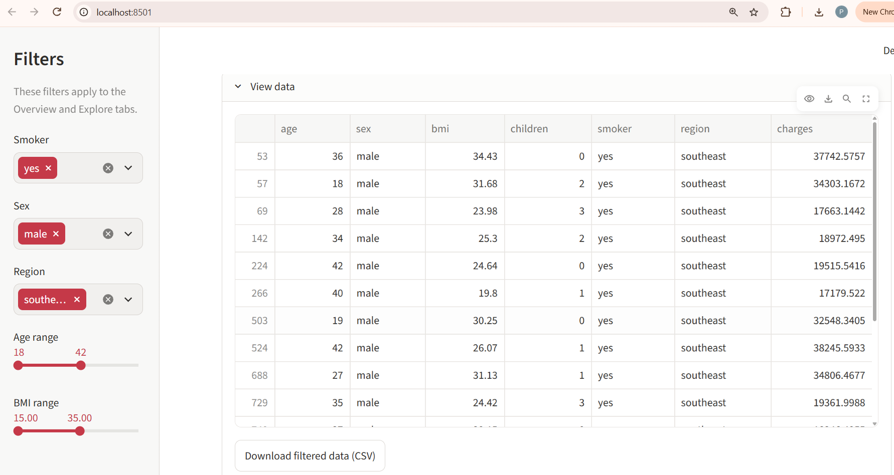

# Medical Insurance Cost Analysis & Prediction

Statistical analysis and regression modelling of medical insurance charges using Python.
The project combines **hypothesis testing** (t-test, ANOVA, chi-square, correlation) with
**regression modelling** (linear regression and random forest) to find what drives
insurance costs and to predict them, and includes an **interactive Streamlit dashboard**.

## Problem Statement
Insurers set premiums using personal factors such as age, BMI and smoking status.
This project answers two questions:
1. Which factors have a statistically significant effect on insurance charges?
2. How accurately can charges be predicted from those factors?

## Dataset
- **Source:** [Medical Cost Personal Datasets - Kaggle](https://www.kaggle.com/datasets/mirichoi0218/insurance)
- **Size:** 1,338 records, 7 columns
- **Columns:** `age`, `sex`, `bmi`, `children`, `smoker`, `region`, `charges` (target)

## Architecture



## Tech Stack
Python, Pandas, NumPy, SciPy, Scikit-learn, Matplotlib, Seaborn, Joblib, Streamlit

## Project Structure
```
insurance-cost-analysis/
├── app.py                   # Streamlit dashboard
├── data/                    # put insurance.csv here
├── src/
│   ├── analysis.py          # full pipeline (clean, EDA, tests, models)
│   ├── predict.py           # predict charges for one person (command line)
│   └── make_architecture_diagram.py
├── outputs/                 # generated tables and figures
├── models/                  # saved model
├── docs/
│   ├── architecture.png
│   ├── dashboard-overview.png
│   ├── dashboard-charts.png
│   ├── dashboard-data.png
│   └── PROJECT_REPORT.md
├── requirements.txt
└── README.md
```

## How to Run
```bash
git clone https://github.com/<your-username>/insurance-cost-analysis.git
cd insurance-cost-analysis
python -m venv .venv
.venv\Scripts\activate          # Windows   (Mac/Linux: source .venv/bin/activate)
pip install -r requirements.txt

# download insurance.csv from Kaggle into the data/ folder, then:
python src/analysis.py
streamlit run app.py
python src/predict.py --age 35 --sex male --bmi 28.5 --children 2 --smoker no --region southeast
```

## Interactive Dashboard (Streamlit)
Run the analysis once, then launch the dashboard:
```bash
python src/analysis.py
streamlit run app.py
```
It opens at `http://localhost:8501` with five tabs:

| Tab | What it shows |
|---|---|
| Overview | KPIs, charges distribution, average charges by group, filterable data table |
| Explore | Box plots, scatter plots, correlation heatmap with sidebar filters (smoker, sex, region, age, BMI) |
| Hypothesis Tests | Pick a question, see the test, p-value, effect size and a plain-English decision |
| Model Results | Model comparison (R², RMSE), diagnostics, coefficients, feature importance |
| Predict Charges | Enter a profile, get an estimate and a what-if comparison for smoking status |

### Main dashboard


### Charts


### Data table


## Methodology
1. **Cleaning:** removed duplicates and nulls, standardised text, flagged BMI outliers with the IQR rule.
2. **EDA:** descriptive statistics, skewness, distributions, correlation matrix.
3. **Hypothesis testing** (alpha = 0.05):

   | Test | Question |
   |---|---|
   | Welch t-test | Do smokers and non-smokers pay different charges? |
   | Welch t-test | Do males and females pay different charges? |
   | One-way ANOVA | Do charges differ across the 4 regions? |
   | Chi-square | Is smoking independent of sex? |
   | Pearson correlation | Is BMI linearly related to charges? |
   | Shapiro-Wilk | Are charges normally distributed? |
   | Mann-Whitney U | Non-parametric check of the smoker result |
4. **Feature engineering:** `bmi_obese` (BMI >= 30), `smoker x BMI` interaction, `age^2`.
5. **Modelling:** baseline linear regression, linear regression with engineered features, random forest.
6. **Evaluation:** R², Adjusted R², RMSE, MAE, 5-fold cross-validation, residual diagnostics.

## Results

### Model comparison (80/20 train-test split, random seed 42)

| Model | R² (test) | Adj R² | RMSE ($) | MAE ($) | CV R² (5-fold) |
|---|---|---|---|---|---|
| Linear Regression (baseline) | 0.8205 | 0.8164 | 5,086.9 | 3,592.8 | 0.7256 |
| Linear Regression (engineered features) | 0.8996 | 0.8961 | 3,804.0 | 2,426.1 | 0.8281 |
| **Random Forest (best)** | **0.9190** | **0.9162** | **3,416.9** | **2,140.2** | **0.8407** |

### Key findings
- **Best model: Random Forest** with R² = 0.919 and RMSE of about $3,417. It explains about 92% of the variation in insurance charges, and its average absolute error (MAE) is about $2,140.
- **Feature engineering made a big difference.** Adding `age²`, `bmi_obese` and the `smoker x BMI` interaction raised the linear model's test R² from 0.82 to 0.90 and cut RMSE from about $5,087 to $3,804.
- **Cross-validation confirms the ranking.** Random Forest also had the highest 5-fold CV R² (0.841), followed by the engineered linear model (0.828) and the baseline (0.726).
- **Hypothesis tests:** all seven tests, with test statistics, p-values, decisions and effect sizes, are saved in `outputs/hypothesis_test_results.csv` and can be explored interactively in the dashboard's **Hypothesis Tests** tab.
- **Model check:** residuals are not perfectly normal (Shapiro-Wilk p < 0.001), which is expected because charges are right-skewed.

## Visuals
Figures are saved in `outputs/figures/`: charges distribution, smoker vs charges, age and BMI scatter plots, correlation heatmap, model diagnostics, model comparison, coefficients and feature importance.

## Limitations and Future Work
- The dataset is small (1,338 rows) and from the US, so results may not generalise to other populations.
- Charges are right-skewed and residuals are not normal, so a log-transformed target or gradient boosting could be tried.
- The model is educational and is not a real insurance quote.
- Deploy the dashboard publicly on Streamlit Community Cloud.

## Author
**Vallepa Akhil** | BSc Statistics, SV Degree College, Anantapur
